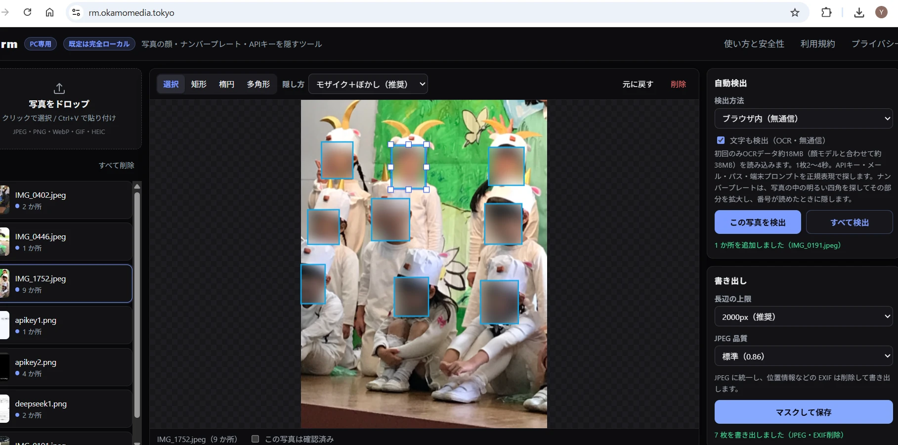
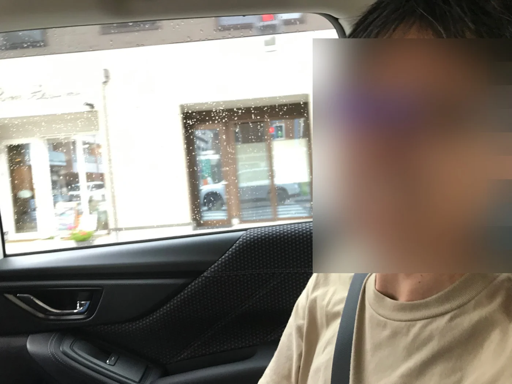
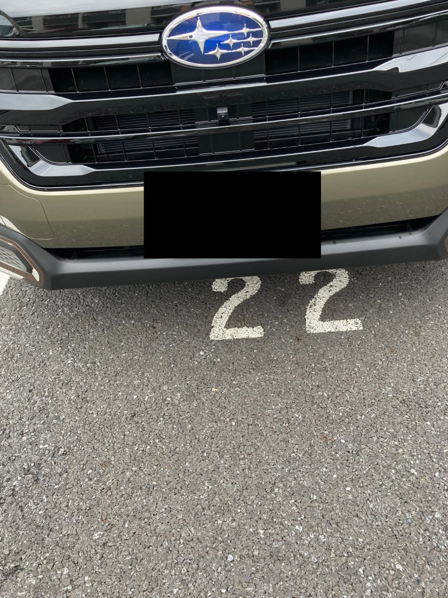
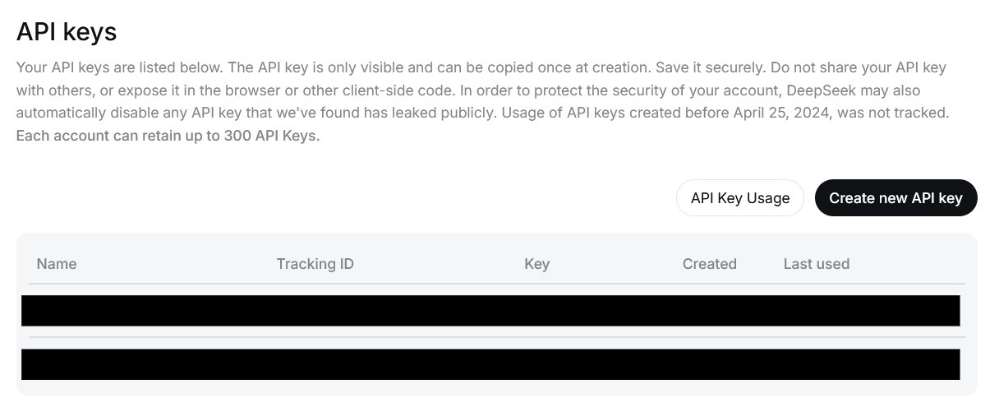
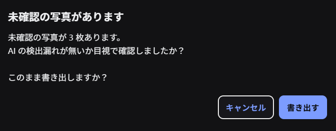
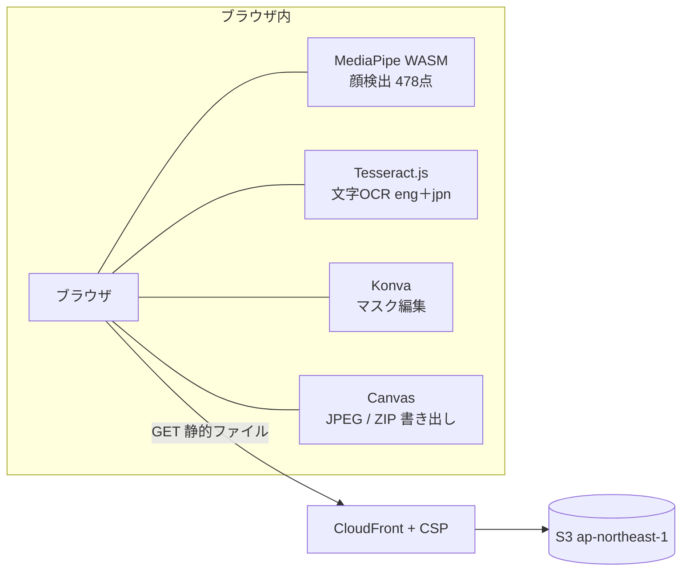

# rm

**写真の顔・ナンバープレート・APIキー・ユーザー名を、ブラウザで隠すツール。**

公開: **https://rm.okamomedia.tokyo/** ・ MIT License

[](https://rm.okamomedia.tokyo/)

既定は**完全ローカル（無通信）**。顔も文字（ナンバープレート・APIキーなど）もブラウザ内で検出できます。
画像が当サイトのサーバーに送信されることはありません。

---

## できること

- **PC 向け** — 大きな画像とローカル AI を扱うため、デスクトップのブラウザ（PC）を想定しています。狭い画面では 1 カラムに積んで表示しますが、スマートフォンでの動作は保証していません（まず 1 枚だけでお試しください）
- **複数枚をまとめて処理** — ドラッグ＆ドロップ / ファイル選択 / `Ctrl+V` 貼り付け
- **入力形式** — JPEG / PNG / WebP / GIF（先頭フレーム）/ BMP / AVIF / HEIC（変換）
- **手動マスク** — 矩形・楕円・多角形（頂点をドラッグで調整）、移動・リサイズ・削除・元に戻す
- **隠し方** — モザイク＋ぼかし / モザイクのみ / ぼかしのみ / 黒塗り
- **自動検出**
  - 顔、ナンバープレート
  - APIキー・トークン・パスワード・秘密鍵
  - メールアドレス・電話番号・住所・氏名
  - ターミナルのユーザー名・ホスト名・フォルダパス（プロンプトだけの行は対象外）
  - IPアドレス・内部URL・クラウドのアカウントID・バケット名
- **初期値は「ブラウザ内（無通信）」** — 顔検出。**ローカルOCR**をONにすると、APIキー・メール・パス・端末プロンプト・日本語のナンバープレートも無通信で検出（英語＋日本語）
  - 初回のみ 顔モデル＋OCR で約38MB、以後キャッシュ。2回目以降は1枚0.5〜2秒（4000px級は2秒前後）
- **顔の精度補正** — 外部 AI が返す粗い顔矩形を、ブラウザ内の顔検出（478ランドマーク）でタイトに補正
- **一括書き出し** — JPEG に統一 / 長辺リサイズ / **EXIF（GPS等）を削除** / 複数枚は ZIP
- **結果プレビュー** — 背景は常にマスク後の結果。枠は常に表示されるので、隠し方を変えた瞬間に見え方が変わる
- **確認済みチェック** — 未確認のまま書き出すと警告（アプリ内モーダル）

### 画面

いずれも **ブラウザ内（無通信）** の検出結果です。

| 顔（モザイク＋ぼかし） | ナンバープレート（黒塗り） |
|---|---|
|  |  |

| APIキーの黒塗り | 検出から書き出しまで |
|---|---|
|  |  |

未確認のまま書き出そうとすると、目視確認を促す警告が出ます。



---

## 使い方

### Web で使う

**https://rm.okamomedia.tokyo/** を開くだけ。インストール不要です。

1. 写真をドロップ（複数可）。スクショは `Ctrl+V` で貼り付け
2. 「自動検出」で方法を選び、「この写真を検出」または「すべて検出」。ブラウザ内なら **「文字も検出（OCR）」** にチェック
3. 枠をドラッグして調整（枠を描き終えると自動で「選択」に戻ります。四隅のハンドルでサイズ変更 / `Delete` で削除 / `Ctrl+Z` で元に戻す）
4. 「隠し方」を変えるとプレビューに即反映（枠を選ぶとその枠だけ、未選択なら全ての枠）。背景は常に結果表示なので、そのまま仕上がりを確認できます
5. 「この写真は確認済み」にチェック
6. 「マスクして保存」（1枚なら JPEG、複数枚なら ZIP）

ショートカット: `V` 選択 / `R` 矩形 / `E` 楕円 / `P` 多角形 / `Delete` 削除 / `Ctrl+Z` 元に戻す

### ローカルで使う（git clone）

```bash
git clone https://github.com/okamoto53515606/rm.git
cd rm
./scripts/dev.sh
```

`http://localhost:5173/` が開きます。初回のみ依存パッケージと顔検出モデル（約3.6MB）・WASM（約15MB）を取得します（合計 約18MB、以後キャッシュ）。

```bash
npm install
npm run dev      # 開発サーバー
npm run build    # dist/ へ本番ビルド
npm run preview  # ビルド結果の確認
```

**ネットにつながない使い方**: 「ブラウザ内（無通信）」を選べば、顔も文字も端末内で検出され、画像も一切送信しません。
モデルはローカル配信なので、一度読み込んだ後はオフラインでも動作します。

---

## プライバシーとセキュリティ

| 項目 | 取扱い |
|---|---|
| 画像 | ブラウザ内で処理。外部のサーバーへ送信しない |
| 書き出し | Canvas で再エンコードするため、位置情報（GPS）・撮影機材・日時は残らない。ブラウザによっては色空間と画素サイズだけを含む最小の Exif が付く（識別情報は含まない） |
| アクセス解析 | なし（Cookie・広告・外部フォント・外部CDN も不使用） |
| 通信先の制限 | CloudFront の **CSP** で localhost 以外への送信をブロック |
| 配信 | S3 は非公開 + CloudFront OAC。S3 への直接アクセス不可 |

- 通信先は CSP で localhost に限定しているため、画像が外部のサーバーに送信されることはありません。
- 「ブラウザ内」は顔（MediaPipe）も文字（Tesseract.js）も端末内で完結します（各ライブラリのテレメトリも CSP で遮断）。
- AI の検出は 100% ではありません。「確認済み」を付けるまで書き出し時に警告します。
- ソースは MIT で公開しているので、通信先や保存の有無は誰でも検証できます。

### 速度と精度の目安

- **ブラウザ内（既定）**: 顔は約0.3秒、文字（ローカルOCR）込みで 1枚 0.5〜2 秒（4000px級は2秒前後）。集合写真は顔を分割検出するため 2〜3 秒かかることがあります
- **ローカルOCR**（Tesseract.js＋正規表現）は、決まった形式の文字列に強く、小さい・斜めの日本語は苦手です。

> 注意: 静的配信基盤（CloudFront / S3）には、通常のWebアクセスと同様に
> IPアドレス・User-Agent などの**アクセスログ**が残る場合があります。画像の中身や編集内容は含まれません。

---

## 技術メモ（エンジニア向け）

### 構成



**バックエンドなし。** Lambda / API Gateway / DB は使いません。
画像がサーバーを通らない構造そのものが、プライバシー設計の担保になっています。

### スタック

| 領域 | 採用技術 |
|---|---|
| ビルド | Vite 8 + TypeScript 7（strict） |
| 描画・編集 | Konva 10（Transformer でリサイズ、頂点ハンドルで多角形編集） |
| 顔検出 | MediaPipe Tasks Vision `FaceLandmarker`（BlazeFace系検出器 + 478点メッシュ） |
| ローカルOCR | Tesseract.js 7（eng＋jpn モデル・約18MBを自己ホスト、WASM）＋正規表現 |
| 実行環境 | WebAssembly（CPU: XNNPACK / 対応環境では WebGL GPU delegate） |
| 画像デコード | `createImageBitmap`（EXIF向き反映）、HEIC は `heic2any` を遅延ロード |
| ZIP | `fflate`（JPEG は再圧縮しないので store モード） |
| 配信 | S3（ap-northeast-1）+ CloudFront（OAC）+ ACM（us-east-1） |
| IaC | CloudFormation（`template.yaml`） |

### ローカルOCR（無通信の文字検出）

「文字も検出（OCR）」をONにすると、Tesseract.js をブラウザ内で動かして文字を読み取ります。
worker・WASMコア・英語/日本語モデルはすべて `public/ocr/` から自己配信し、外部への通信はありません。

1. 画像を長辺 1600px に縮小
2. 暗い画面（ターミナル）は白黒反転してから認識
3. 行ごとのテキストに正規表現を適用し、該当行をマスク
4. ナンバープレートが見つからないときは、画像を 240px に縮小して「白くて明るい横長の領域」を探し、
   その矩形を元解像度から切り出して拡大（幅700px）し、番号が読めるかを確かめる。
   読めたら、その矩形（プレート全体）をマスクする

対象: Google/AWS/OpenAI/GitHub/Slack のキー、JWT、秘密鍵ヘッダ、メール、IP、認証付きURL、
`/home/...` などのパス、`user@host:~/dir$ command` のようなプロンプト付きの行（プロンプトだけの行は除く）、
`OPENAI_API_KEY = ...` などの代入、
日本のナンバープレート（地名＋分類番号＋ひらがな＋4桁）。

> 日本語モデルを同梱していますが、小さい・斜め・低コントラストの文字は誤認識します。
> OCR の誤認識で漏れることもあるため、公開前の目視確認をおすすめします。
> 日本語モデルが無い場合は自動で英語のみにフォールバックします。

#### ナンバープレート検出がむずかしい理由

作ってみて分かった制約と、それに対する今の設計です。

- **Tesseract は「画像全体に対して小さい文字」を無視する。** 4032×3024 の写真では、プレートは面積の 1% 程度。
  全体をどんなに拡大しても、ページ分割の段階で「文字がない」と判断されて落ちます。
- **総当たりで分割拡大すると遅すぎる。** 画像を 4 分割して拡大し、日本語モデルで読むと
  **1 枚あたり 10〜20 秒**かかり、しかも読めないことが多い（テクスチャの多い写真ほど遅い）。
- そこで **「プレートを先に見つけて、そこだけ読む」** 方式にしています。
  白さ（無彩色の明るさ＋黄色）の積分画像で横長の明るい領域を探し、しきい値を超える範囲まで広げて
  プレート矩形を決め、その部分だけを元解像度から切り出して幅 700px で OCR します（0.1〜0.4 秒）。
  黄ナンバー（軽自動車）も対象です。
- **候補は最大 4 つまで試す。** 1枚に複数台写っていても拾えるようにしています。読めなければ、それ以上リトライせずに諦めます（待ち時間を優先）。
- 上段の「地名＋分類番号」は文字が小さく誤読しやすいため、判定は**下段の番号**を主な手がかりにし、
  隠す範囲はプレート全体にしています。`PSM`（ページ分割モード）も、全体は自動・切り出しは単一ブロックと使い分けています。
- 下段の番号は `12-34` のほか、`99 99`（空白区切り）や `12・34`（中黒・ピリオド区切り）、
  ひらがなや区切り記号が読めず数字だけの行になっても拾えるようにしています。

#### 検出できない（苦手な）パターン

次のような写真は、現状のブラウザ内検出では見つけられないことがあります。
自動検出に頼らず、手動の枠も併用してください。

| パターン | 理由 |
|---|---|
| プレートが極端に小さい（長辺の 5% 未満） | 切り出しても文字が数 px になり、OCR が読めない |
| 傾きが強い（おおむね 30° 以上） | 矩形探索が軸に沿うため、プレート領域を取れない |
| 数字が 2 桁未満しか読めない（例: `・・ ・9`） | プレート番号として確定できない（誤検出を避けるため） |
| 強いぼけ・夜間の白飛び/黒つぶれ・色かぶり | 白/黄の領域判定と OCR の両方が失敗する |
| 汚れ・雪・カバー・反射で文字が隠れている | 文字が存在しないため読めない |
| 原付・自転車の小さいプレート | 面積が小さく、明るい領域の探索対象から外れる |

実写真 `IMG_1369.jpeg` は、数字の行は読めるもののプレートとして確定できず、
現在は未検出です（2026-11 時点）。このような場合は手動で矩形を描いてください。
Ollama モード（`lfm3-vl:2b`）では、この写真のプレートを1件検出できました（初回 約27秒）。
ブラウザ内で読めない場合は、Ollama を併用する選択肢があります。

### マスク描画と書き出し

- マスク形状（矩形/楕円/多角形）で `clip()` し、領域内だけ加工
- モザイク: 領域を縮小→`imageSmoothingEnabled = false` で拡大
- ぼかし: `ctx.filter = blur(...)`（強さはマスクの短辺に比例）
- 書き出し: `canvas.toBlob('image/jpeg')` → **メタデータは自動的に落ちる**
- 複数枚は `fflate.zipSync(..., { level: 0 })` でZIP化

### 検出精度のテスト

`test-image-secret/`（gitignore 済み）に実写真・合成画像を置き、
ブラウザ内検出だけの精度（再現率・適合率）と処理時間を測れます。

```bash
npm run test:eval:gen   # 合成画像（プレート・機密文字列・顔の合成）を生成
npm run test:eval       # ヘッドレス Chromium で評価 → test-image-secret/eval-out/
npm run test:compare    # 全画像の「マスク前 / 検出枠 / マスク後」を HTML レポート化
```

結果は `report.json` と、正解を緑の破線・検出を実線で重ねた PNG です。
テストデータの集め方や判定方法は `test-eval/README.md` を参照してください。

#### テスト結果サマリー（2026-11-10）

テスト画像は `test-image-secret/`（gitignore 済み）に置いており、リポジトリやこの README には
写真そのものを含めていません。以下はパターンと件数だけの記録です。

| テストパターン | 件数 |
|---|---|
| 合成ナンバープレート（正面・小さい・8度傾き・2台・夜間） | 5 |
| 合成ナンバープレート（白い看板・誤検出確認） | 1 |
| 合成の機密文字列（明るい画面・ターミナル・表形式） | 3 |
| 合成の機密文字列（機密なし・誤検出確認） | 1 |
| 顔（2人合成・公有領域の肖像3） | 4 |
| 実写真（既存: 顔1・プレート1・APIスクショ1） | 3 |
| 実写真（追加: 顔3・プレート1・APIキー2） | 6 |
| **合計** | **23** |

| 結果 | 値 |
|---|---|
| ブラウザ内（全23枚） | マスク 40 か所 / エラー 0 / 平均 1.4 秒 |
| 検出の内訳 | 顔 18・ナンバープレート 7・機密文字列 15 |
| 評価セット（14枚・正解25個） | 再現率 96% / 適合率 100% |
| 0件だった画像 | 実写真1枚（プレート）＋負例2枚（意図どおり） |

0件だった実写真（ナンバープレート）は、Ollama モードの `lfm3-vl:2b` では1件検出できました。
ブラウザ内の検出は高速・無通信ですが、苦手なパターンは Ollama で補完できます。

### CSP（CloudFront のレスポンスヘッダー）

```
default-src 'self'; base-uri 'self'; object-src 'none'; frame-ancestors 'none'; form-action 'self'; script-src 'self' 'wasm-unsafe-eval'; style-src 'self' 'unsafe-inline'; img-src 'self' data: blob:; font-src 'self' data:; worker-src 'self' blob:; child-src 'self' blob:; connect-src 'self' http://localhost:* http://127.0.0.1:* https://localhost:* https://127.0.0.1:*
```

`connect-src` を localhost に絞ることで、「画像を自分の PC の外に出さない」をブラウザ側で強制しています。

### ファイル構成

```
.
├── index.html            アプリ本体（SPA）
├── src/
│   ├── app.ts            UI・状態管理・書き出し
│   ├── editor.ts         Konva によるマスク編集
│   ├── image.ts          デコード / マスク描画 / JPEG化
│   ├── detect.ts         ローカル顔検出 / ハイブリッド補正
│   ├── types.ts         型定義
│   ├── util.ts           ユーティリティ
│   └── style.css         ブラックテーマ
├── public/
│   ├── terms.html        利用規約
│   ├── privacy.html      プライバシーポリシー
│   └── wasm/ models/     ビルド時に用意（git管理外）
├── scripts/
│   ├── dev.sh            ローカル起動
│   ├── deploy.sh         AWSデプロイ
│   └── prepare-assets.mjs WASM/モデルの配置
├── template.yaml         CloudFormation
└── docs/
    ├── ollama.md         Ollama の手順・解説・実測
    └── screenshot/         README 用画像
```

### デプロイ

```bash
# 既定のAWS認証情報（~/.aws/config の default）を使う
./scripts/deploy.sh

# プロファイル・リージョンを指定する
AWS_PROFILE=my-profile AWS_REGION=ap-northeast-1 ./scripts/deploy.sh
```

独自ドメインを使う場合（ACM証明書は CloudFront の仕様で **us-east-1** 必須）:

```bash
AWS_PROFILE=my-profile \
DOMAIN_NAME=mask.example.com \
ACM_CERT_ARN=arn:aws:acm:us-east-1:123456789012:certificate/xxxxxxxx-xxxx-xxxx-xxxx-xxxxxxxxxxxx \
./scripts/deploy.sh
```

デプロイ後、`DOMAIN_NAME` を CloudFront のドメインへ CNAME してください。
CNAME 先は `aws cloudformation describe-stacks --stack-name rm --query "Stacks[0].Outputs"` で確認できます。

---

## テスト状況

| 検出方法 | 状態 | 備考 |
|---|---|---|
| ブラウザ内（無通信） | ✅ テスト済み | Chrome で顔検出・マスク・書き出しと、ローカルOCR（文字・ナンバープレート）を確認 |
| ブラウザ内OCR | ✅ テスト済み | 合成画像で検出確認（プロンプト/APIキー/伏せ字キー/メール）。実写真（4032×3024）でナンバープレートを検出。1枚 0.3〜1.3秒（プレート探索込） |
| 枠の編集（矩形/楕円/多角形） | ✅ テスト済み | 楕円の作成・ハンドルでの拡大縮小（連続2回）・黒塗り反映をブラウザ内で自動テスト。検出後に選択ツールへ自動復帰 |
| 狭い画面（1カラム） | ✅ テスト済み | 390 / 768 / 900 / 1024 / 1280px で横スクロールが出ないこと、390px で画像の読み込みとキャンバス表示（fit）を確認。パネルの開閉も動作 |
| マスク描画のブラウザ差 | ✅ テスト済み | Chromium / Firefox / WebKit で「描く前後のピクセル差分」を `node scripts/check-mask.mjs <画像> --browser=webkit` で確認。`ctx.filter` が効かない環境（WebKit の一部）では、縮小→拡大のぼかしに自動で切り替える |

### EXIF の実測

GPS・機種名・撮影日時を含む JPEG を入力し、rm で書き出した JPEG を検査しました。

```
入力（元写真）: {"exif":true,"identifying":true,"identifyingTags":["Make","Model","Software","DateTime","DateTimeOriginal","MakerNote","LensModel"]}
Chromium 書き出し: {"exif":false,"gps":false,"identifying":false,"verdict":"Exif なし"}
Safari(iOS) 書き出し: {"exif":true,"gps":false,"identifying":false,
                      "tags":["ExifIFD","ColorSpace","PixelXDimension","PixelYDimension"],
                      "verdict":"識別情報なし（色空間・画素サイズなどのみ）"}
```

検査には `node scripts/check-exif.mjs <file.jpg>` を使用しています。`exif` の有無だけでなく、
**識別につながるタグ**（Make / Model / DateTime / GPS / LensModel など）が残っているかを見ます。

- Chromium / Firefox: Canvas 再エンコードで Exif ごと落ちる
- Safari（iOS）: エンコーダが **色空間（sRGB）と画素サイズだけ**の最小 Exif を付ける。
  位置情報・撮影日時・機種名は含まれない（`identifying: false`）

---

## 経緯

このツールは、源 勝（みなもと まさる）さんの note 記事と、そのコメント欄でのやりとりから生まれました。

- 記事: [フォト消しプライバシーを買って試してみた！ Mac mini M1 8GB でも高速に動いた](https://note.com/minamotomasaru/n/n93801e4d557f)

### okamo が感動したこと

記事で紹介されていた「フォト消しプライバシー」は、**153.6MB** のアプリなのに M1 Mac（メモリ8GB）で高速に動き、
**インターネットを切っても動く**。中では小さなエッジ向けモデルを組み合わせているらしい。

源さんは記事の最後に「小さな AI で製品を作る人たちへのリスペクト」と題して、こう書いています（抜粋）。

> 今回の購入は、誰かに依頼されたわけでも、PR を頼まれたわけでもありません。
> ソースネクストのアフィリエイトに参加しているわけでもなく、自分が気になったので、自腹で購入して試してみました。
>
> それでも、こういう小さなモデルを選び、実際に使える製品に仕上げている人や企業は、ほんと尊敬してしまいます。
>
> なんというか、でっかい高性能な最新モデルを使えば何でもできる！ という流れに、別の方向から挑んでいるように見えるんですよね。
>
> ちょっとロックな感じというか、反骨精神というか。🎸

「大きなモデルでできることよりも、小さなモデルで工夫して実現できていることのほうが、圧倒的にカッコよく見える」
——この姿勢に強く惹かれました。

### コメントのやりとり（要約）

- **okamo**: ブログを書くとき、写真の顔やスクショ内の API キーを黒塗りするのが面倒。
  OSS で、しかも Web サービスですぐ使えたら便利そう。
- **源さん**: 自分の知識や経験では、その要望を叶えるアプリは作れないだろう。
  AI に頼めば何でもできるという風潮には、自分はあまり乗れそうにない……。

そこで「じゃあ、ブラウザだけで動くものを公開しよう」と作ったのが rm です。
画像をサーバーに送らず、小さな顔モデルをブラウザ内（WebAssembly）で動かす構成は、
源さんの記事の「小さなモデル」の話を、そのまま Web に持ち込んだものです。

### かんたんに言うと（MediaPipe・WebAssembly・Tesseract）

rm の検出は、サーバーではなく**利用者のブラウザの中**で動いています。
その中心にあるのが **WebAssembly** と、その上で動く **MediaPipe Tasks Vision**（顔）・**Tesseract.js**（文字）です。
名前だけ聞くと難しそうですが、役割はとても単純です。

#### WebAssembly（WASM）って？

ブラウザが理解できる「高速なプログラムの形式」です。
ふつう Web のプログラムは JavaScript で書きますが、WebAssembly を使うと、
C++ などで書かれた**重い画像処理や AI の計算**を、そのままブラウザの中で速く動かせます。

たとえるなら、**ブラウザの中に小さなアプリを1つ入れて動かす**ようなものです。
データをサーバーに送らないので、待ち時間がなく、プライバシーも守られます。

#### MediaPipe Tasks Vision って？

Google が無料公開している、**端末の中で動く AI の部品箱**（オープンソース）です。
その中の「FaceLandmarker」という部品は、写真から顔を見つけて、
**目・鼻・口・輪郭など 478 個の点**の位置を返します。

「顔があるよ」という四角だけでなく、顔のパーツの位置まで分かるので、
髪の毛や背景を含まない、ぴったりの範囲を作れます。

#### Tesseract.js って？

**ブラウザの中で動く文字認識（OCR）のエンジン**です。
もともと長く使われているオープンソースの OCR「Tesseract」を、WebAssembly に変換して
JavaScript から使えるようにしたものが Tesseract.js です。

写真やスクリーンショットから文字を読み取り、**その行がどこにあるか（四角の座標）**も返してくれます。
rm では、読み取った行に正規表現を当てて「APIキー」「メールアドレス」「ナンバープレート」などを探し、
見つかった行をそのままマスクします。

英語と日本語のモデル（`eng` / `jpn`）を `public/ocr/` から自己配信しているので、
ここでも外部への通信はありません。

#### これらを組み合わせると

- 画像を**1枚もサーバーに送らずに**、顔も文字も検出できる
- 初回だけモデル（顔モデル 3.6MB + OCR のエンジンとモデル約18MB）を読み込み、以後はブラウザにキャッシュされる
- 一度読み込めば**オフラインでも動く**
- 無料・無制限（APIキー不要）

「小さなモデルを、身近なブラウザで動かす」——源さんの記事にあった考え方を、
そのまま Web の形にしたのが rm です。

| 用語 | かんたんな説明 |
|---|---|
| WebAssembly | ブラウザ内で動く高速なプログラム形式。重い計算を端末内で実行できる |
| MediaPipe Tasks Vision | Google 製の端末内 AI 部品箱。顔の 478 点を検出するモデルなどを含む |
| Tesseract.js | ブラウザ内で動く文字認識（OCR）。読み取った行の位置も返す |
| モデル | AI の「脳みそ」。rm の顔検出モデルは約3.6MB、OCR の言語モデルは `eng`＋`jpn` で約6.6MB（WASMは別途） |

### 名前の由来

**rm** には2つの意味があります。

1. **remove** — 写真からプライバシー（顔・ナンバー・秘密）を消す
2. **rock minamoto** — 源さんの「ロック精神」へのリスペクト

> 源さんの記事・コメントは公開情報からの要約です。記事HTMLのコピー（開発時のメモ）は
> 著作権に配慮してリポジトリに含めていません。

### 開発の裏側

このツールは、AI コーディングアシスタント（DeepSeek V4.1 Flash）とのやりとりだけで作られました。
設計の相談から実装・AWS デプロイ・つまずいた点まで、開発ログをそのまま公開しています。

- [開発ログ（2026-11-08）](prompt_history/20261108_deepseek-v4.1-flash.txt)

> ログ内の API キー・AWS アカウントID・証明書 ARN・ホスト名・メールアドレスはマスク済みです。

---

## Ollama で文字も検出する（任意）

既定の「ブラウザ内（無通信）」に加えて、**Ollama** を使うと、画像を PC の外に出さないまま
多言語・文脈判断のある文字検出に切り替えられます。既定モデルは `lfm3-vl:2b`（約 1.5GB）です。

インストール（WSL2）・モデル取得・`OLLAMA_ORIGINS` の設定・Chrome の許可ダイアログ・
つまずきやすい点・実測値は、次のページにまとめています。

→ **[docs/ollama.md](docs/ollama.md)** — Ollama と LFM3-VL-2B のやさしい説明から、セットアップ手順まで

---

## ライセンス

MIT
