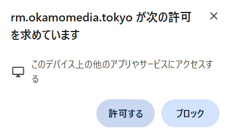

# Ollama で文字も検出する（ローカル LLM）

rm は既定で **ブラウザ内（無通信）** で顔と文字を検出します。
Ollama を使うと、画像を PC の外に出さないまま、より柔軟な文字検出に切り替えられます。

このページは、Ollama をはじめて触る人向けの説明と、この PC（WSL2）で実際に使ったセットアップ手順をまとめたものです。

---

## 1. Ollama とは

**自分の PC の中で大規模言語モデル（LLM）を動かすためのアプリ**です（オープンソース）。

- `ollama pull <モデル名>` でモデルをダウンロード
- `ollama serve` で API サーバーを起動（既定は `http://localhost:11434`）
- アプリは HTTP で「この画像のどこを隠すべきか」を聞き、JSON で答えを受け取る

クラウドの AI API との違いは次のとおりです。

| | Ollama（ローカル） | クラウド API |
|---|---|---|
| API キー | 不要 | 必要 |
| 料金 | 無料（電気代のみ） | 従量課金 |
| 画像の送信先 | 自分の PC（localhost） | 事業者のサーバー |
| ネット接続 | モデルの取得時だけ | 毎回必要 |
| 速度 | PC の性能しだい | 速い |

rm は「画像を外に出さない」ことを優先して、Ollama だけに対応しています。

## 2. LFM3-VL-2B とは

**Liquid AI** の「LFM3」ファミリーに属する **視覚言語モデル（VLM）** です。
画像と言葉を一緒に扱える小型モデルで、「写真や画面のどこに何があるか」を言葉で答えるのが得意です。

| 項目 | 内容 |
|---|---|
| パラメータ | 1.92B（言語 1.73B + 視覚エンコーダ 164M + プロジェクタ 25M） |
| 入力 | テキスト・画像（動画は今後対応予定） |
| コンテキスト長 | 128K トークン |
| 対応言語 | 日本語を含む16言語 |
| Ollama でのサイズ | 約 1.5GB（既定タグ = Q4_K_M） |
| ライセンス | LFM Open License v1.0 |

- 得意: 画面写真の読み取り、図表、物体の位置、空間的な関係
- 苦手（配布元の注意書き）: コーディング、長い会話、複雑な推論
- 「考える（thinking）」機能があり既定は有効ですが、**rm では速さを優先して無効**にしています（検出結果は変わりませんでした。1枚 44秒 → 15秒）

> 2B（20億パラメータ）は小型です。7B 級のような安定性はないため、**同じ画像でも結果が変わることがあります**。
> 検出は「候補を出す」道具として使い、最後は目視で確認してください。

## 3. アプリでの使い方

1. 「自動検出」の **検出方法** で `Ollama（ローカルLLM）` を選ぶ
2. **モデル名** が `lfm3-vl:2b` になっていることを確認（既定値）
3. 写真を追加して「この写真を検出」

エンドポイントは `http://localhost:11434` のまま使います。localhost / 127.0.0.1 以外を指定すると、
CSP の制限によりエラーになります。

初回だけ、Chrome がローカルネットワークへのアクセスを確認します。「許可する」を選んでください。
（拒否した場合は、アドレスバー左のサイト設定 →「ローカルネットワーク」から変更できます）



---

## 4. セットアップ（WSL2 + systemd）

この PC（Windows 11 + WSL2 の Ubuntu 22.04）で実際に使った手順です。

### 4.1 インストール

```bash
sudo apt-get install -y zstd            # インストーラが使うため必須
curl -fsSL https://ollama.com/install.sh -o /tmp/ollama-install.sh
sudo sh /tmp/ollama-install.sh
```

- `/usr/local/bin/ollama` に本体が入り、systemd ユニット `ollama.service` が作られます
- **古い Ollama が `/usr/bin/ollama` に残っていると、そちらが優先されて古い版で動くことがあります**。
  `which ollama` と `ollama --version` を確認し、古い方は削除してください

```bash
which ollama                    # /usr/local/bin/ollama になっているか
ollama --version
```

### 4.2 モデルの取得

```bash
ollama pull lfm3-vl:2b          # 約1.5GB
ollama list                     # 取得できたか確認
```

### 4.3 起動

```bash
sudo systemctl enable --now ollama   # 起動 + PC 再起動後も自動起動
systemctl is-active ollama           # active なら OK
```

一時的に手元で動かすだけなら `ollama serve` でも構いません。

### 4.4 公開版（https://rm.okamomedia.tokyo）から使う場合の CORS 設定

Ollama は既定で、`localhost` 以外のオリジンからのアクセスを拒否します。
systemd の drop-in で、このサイトのオリジンだけを許可します。

```bash
sudo mkdir -p /etc/systemd/system/ollama.service.d
printf '[Service]\nEnvironment="OLLAMA_ORIGINS=https://rm.okamomedia.tokyo"\n' \
  | sudo tee /etc/systemd/system/ollama.service.d/override.conf
sudo systemctl daemon-reload
sudo systemctl restart ollama
```

- `OLLAMA_ORIGINS` を設定しても、**localhost / 127.0.0.1 は引き続き許可**されます（`npm run dev` の検証はそのまま使えます）
- ローカル開発だけなら、この設定は不要です

### 4.5 動作確認

```bash
curl -s http://127.0.0.1:11434/api/tags    # 取得済みモデルの一覧（JSON）
ollama ps                                  # メモリに載っているモデルと CPU/GPU 比
```

---

## 5. つまずきやすいところ

### `target IP address space of 'local' yet the resource is in address space 'loopback'`

Chrome 142 以降の **Local Network Access（LNA）** のエラーです。
ブラウザは接続先を `loopback`（自分の PC）/ `local`（LAN）/ `public` に分けて判定し、
リクエストの宣言と実際のアドレス空間が食い違うとブロックします。
`localhost` は `loopback` です。rm は接続先に応じて正しく宣言するよう修正済みなので、
このエラーが出る場合はページを再読み込みしてください。

### `Ollama がこのオリジンからのアクセスを拒否しました（403）`

`OLLAMA_ORIGINS` は**完全一致**です。`https://rm.okamomedia.tokyo` と `http://localhost:5173` は別物として扱われます。
4.4 の設定を確認し、変更後は `systemctl restart ollama` を忘れずに。

### 遅い / メモリに載らない

- `ollama ps` の `PROCESSOR` 列で CPU と GPU の比率を確認できます。
  GPU メモリが少ない PC（例: 2GB）では `72%/28% CPU/GPU` のような部分オフロードになります
- モデルは**最終アクセスから約5分でメモリから外れます**。その後の1枚目はロード時間が加算されます
- メモリ不足で落ちる場合は、他のアプリを閉じるか、より小さいモデルに変更してください

### ポート 11434 が使えない

`OLLAMA_HOST=127.0.0.1:11500 ollama serve` のように変更できます。
rm 側は「Ollama エンドポイント」欄で URL を変えられます（localhost / 127.0.0.1 のみ）。

---

## 6. 性能の実測

公開版 **https://rm.okamomedia.tokyo/** から、PC 上の Ollama に接続して検出した結果です。

- 環境: Windows 11 / WSL2（Ubuntu 22.04）・12 コア・メモリ 15GB・GeForce MX250（2GB）
- Ollama 0.40.15 / `lfm3-vl:2b`（Q4_K_M）。GPU メモリが 2GB のため 72% CPU / 28% GPU の部分オフロード

| テスト画像 | 検出結果 | 所要時間 |
|---|---|---|
| APIキー一覧のスクリーンショット（1216×501） | APIキー 2か所 | 約13秒 |
| ナンバープレートの写真（4032×3024） | プレート 1か所 | 約14秒 |
| 顔写真（4032×3024） | 顔 1か所 | 約14秒 |

- 3枚まとめて約41秒。モデルの初回ロードを含む1枚目だけは約87秒かかりました
- 2B モデルなので出力は完全には安定しません（同じスクリーンショットで 2か所→0か所になった例があります）
- 顔の枠はやや大きめに出ます。ブラウザ内の顔検出（478点）が顔を見つけられた場合は、そちらでタイトに補正されます

### rm が Ollama に送るもの

1. 元画像を長辺 **1536px** に縮小した JPEG（品質 0.85）
2. 検出用のプロンプト（対象・座標の形式を指定）
3. `format: "json"` / `think: false` / `temperature: 0`

応答の `box_2d` は **`[xmin, ymin, xmax, ymax]` の 0〜1000 正規化座標**として解釈します
（LFM3-VL / Qwen-VL 系の形式）。LFM3-VL は「正規化した [上, 左, 下, 右]」と指示しても
x を先に返すため、rm 側で順序を合わせています。

### 検出後の後処理

1. 0〜1000 の正規化座標を、元画像のピクセルへ逆変換（縮小しても比率は変わらない）
2. **ハイブリッド補正**: ブラウザ内の顔検出（478点）の矩形と、小さい方の面積比で 0.5 を超えて重なる場合、
   VLM の粗い顔矩形を捨ててローカルのタイトな矩形を採用。VLM が見落とした顔もローカル側で追加
3. 文字カテゴリは端の半文字が残らないよう、外側に画像の 0.4% だけパディングしてからマスク

モデルは、この用途に必要十分な `lfm3-vl:2b`（約1.5GB / Q4_K_M）を既定にしています。
7B 級を CPU で回すと 1 枚に数分かかりますが、2B なら実用範囲の時間で返ります。

---

## 7. 注意

- 2B モデルのため、検出漏れ・誤検出はあります。最終確認は目視で行ってください
- 送信先は localhost に限られます。公開版は CSP（`connect-src`）で localhost 以外をブロックしており、
  アプリ側も localhost / 127.0.0.1 以外を指定するとエラーを出します
- モデルの利用条件は配布元（LFM Open License v1.0）に従ってください
- **LAN 上の Ollama は使えません**。使いたい場合は `template.yaml` の `connect-src` を変更し、
  `src/detect.ts` の localhost チェックも外して自前デプロイしてください

## 8. 停止・再開

```bash
sudo systemctl stop ollama     # 停止
sudo systemctl start ollama    # 再開
sudo systemctl disable ollama  # PC 再起動時の自動起動をやめる
```

ブラウザのみで試したいときは停止しておくと、Ollama を選んだときに接続エラーの表示も確認できます。
